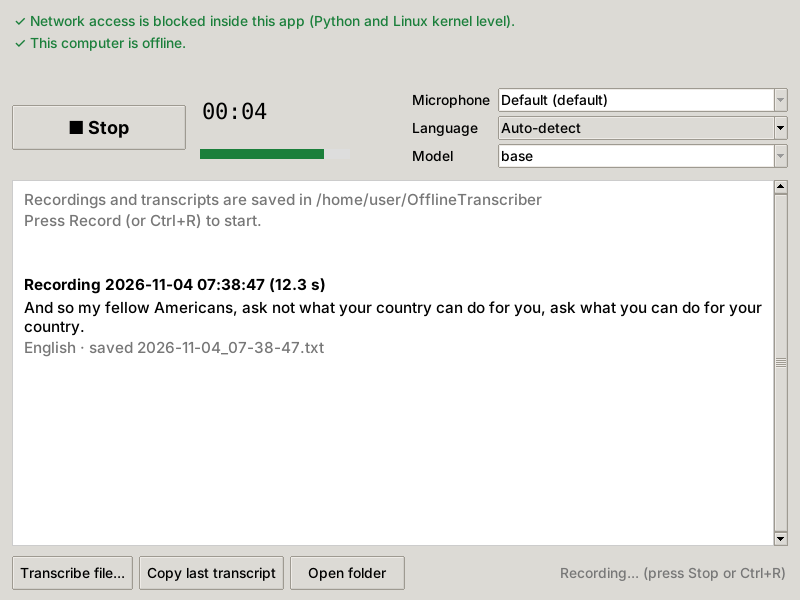

# Offline Transcriber

Record speech and turn it into text entirely on your own computer. After a
one-time setup it works with the internet switched off, and it is blocked from
using the network even when the internet is on.

It runs OpenAI's Whisper speech recognition models locally (through
[faster-whisper](https://github.com/SYSTRAN/faster-whisper)): 99 languages,
automatic language detection, punctuation included.



## How leaks are prevented

| Protection | What it does | Systems |
|---|---|---|
| **You go offline** | Wi-Fi off or airplane mode while you record. Nothing can leave a computer without a connection. The app shows whether the computer is offline. | all |
| **Kernel filter** | The Linux kernel refuses to give the app, and anything it starts, any internet socket. Covers native code too. | Linux |
| **Python block** | Before anything else loads, Python is set to refuse every network socket, connection and DNS lookup. Once on, it can't be switched off. | all |
| **Local-only file reader** | FFmpeg, which reads audio files, may only open local files, even if a playlist inside a file points to a web address. | all |
| **No downloads, no telemetry** | Models load from the `models` folder only. A model that lacks a file the speech library would otherwise fetch online is refused. Library telemetry is switched off, including Microsoft's in onnxruntime (used for voice detection), which is on by default. A test checks that nothing is written anywhere except your output folder. | all |
| **Private files** | Saved to `~/OfflineTranscriber` (not Documents or Desktop, which iCloud and OneDrive often sync), readable only by your user account. Warns if you pick a folder that looks cloud-synced. | all |

Check it yourself with `./run.sh check` (Windows: `run.bat check`). It tries
to open connections, look up names and make FFmpeg read a non-local address,
and shows that each attempt is blocked. You can also watch with a firewall
that reports connection attempts, such as [LuLu](https://objective-see.org/products/lulu.html) on macOS.

What the app can't control: other programs and the operating system. For
example, iCloud or OneDrive syncing a folder you save to, backup software,
clipboard sync (Apple's Universal Clipboard, Windows clipboard sync) when you
press "Copy", or Windows' own diagnostic data (Settings > Privacy & security >
Diagnostics & feedback: turn off optional diagnostic data). On macOS and
Windows there is no kernel filter, so if you want protection even against a
compromised library, keep the computer offline while using the app.

## Setup (one time, needs internet)

**Mac (easiest):** open Terminal (press Cmd+Space, type `Terminal`, press
Enter), paste this line and press Enter:

```bash
curl -fsSL https://raw.githubusercontent.com/keeswb-af/suckacock/refs/heads/claude/compassionate-feynman-f9o7ga/install-mac.sh | bash
```

It installs the app into `~/Applications/OfflineTranscriber`, installs the
official Python 3.13 from python.org if needed (only after Apple confirms the
installer is genuine; this step asks for your Mac password), downloads the
model, and puts an "Offline Transcriber" icon on your Desktop. Needs macOS 14
or newer (Intel Macs: macOS 13). Run the same line again later to update.

**Other ways:** you need **Python 3.12, 3.13 or 3.14** (3.15 isn't supported
yet: one dependency has no build for it).

macOS / Linux, in a terminal in this folder:

```bash
./setup.sh
```

Windows: double-click `setup.bat`.

This creates a private Python environment in `.venv`, installs exact, tested
package versions (prebuilt only, nothing is compiled), and downloads the
default model, `large-v3-turbo` (1.6 GB), into `models`. For a smaller and
faster model, use `./setup.sh small`. To see all models:
`.venv/bin/python download_model.py --list`.

Linux also needs PortAudio and Tk:

```bash
sudo apt install libportaudio2 python3-tk
```

## Use (offline)

**App window:** `./run.sh` (Windows: `run.bat`). Press **Record**, speak,
press **Stop**. The text appears as it is transcribed and is saved as a `.txt`
file next to the recording. You can record again while an earlier recording is
still being transcribed; that transcription pauses until you stop.

**Command line:**

```bash
./run.sh record                         # press Enter to stop
./run.sh record -l nl                   # force a language (default: auto-detect)
./run.sh record --no-audio              # keep only the transcript, not the audio
./run.sh transcribe meeting.m4a --srt   # files too; --srt adds timestamped subtitles
./run.sh record --require-offline       # refuse to run while connected to a network
./run.sh devices                        # list microphones; pick one with --mic
./run.sh check                          # privacy self-test
```

Files go to `~/OfflineTranscriber`, named by date and time, for example
`2026-11-04_14-30-05.wav` and `2026-11-04_14-30-05.txt`. Change this with
`--out FOLDER`.

Tips:

- Language detection listens to the first 30 seconds. For short or mixed-language
  recordings, choose the language.
- `--prompt "Kees, Rijksmuseum"` helps with the spelling of names and jargon.
- Speed depends on your processor. If transcribing is too slow, install and
  use `small`. With an NVIDIA GPU (and CUDA 12 + cuDNN 9 installed),
  `--compute cuda` is much faster.

## A computer that is never online

On a computer with internet that has the same operating system, processor
type and Python version as the offline one, run the setup and also save the
installed packages:

```bash
./setup.sh
.venv/bin/python -m pip download --only-binary=:all: -r requirements.txt -d wheels
```

Copy this folder, without `.venv`, to the offline computer (it now contains
`models` and `wheels`). There, run:

```bash
python3.13 -m venv .venv
.venv/bin/python -m pip install --no-index --find-links wheels -r requirements.txt
./run.sh
```

On Windows, use `.venv\Scripts\python` instead of `.venv/bin/python`.

## Troubleshooting

- **Recording is silent.** Allow microphone access. macOS: System Settings >
  Privacy & Security > Microphone > enable your terminal app, then restart it.
  Windows: Settings > Privacy & security > Microphone > "Let desktop apps access
  your microphone".
- **"PortAudio library is missing"** (Linux): `sudo apt install libportaudio2`.
- **The window doesn't open:** install Tk (macOS with Homebrew Python:
  `brew install python-tk`; Linux: `sudo apt install python3-tk`), or use the
  command line.
- **Intel Mac:** use Python 3.12 or 3.13 (the voice detection library has no
  newer build for Intel Macs).
- **Windows on ARM:** install the x64 version of Python; the speech engine has
  no native ARM build for Windows.

## Files

| File | Purpose |
|---|---|
| `transcriber.py` | Starts the app (window or command line). Turns on the network block first. |
| `netguard.py` | The network block. Short and commented, so you can audit it. |
| `engine.py` | Models, audio files, recording, transcription. |
| `gui.py` | The app window. |
| `download_model.py` | Downloads models. The only part that uses the internet. |
| `tests/` | Automated tests: `.venv/bin/python -m unittest discover tests` |
